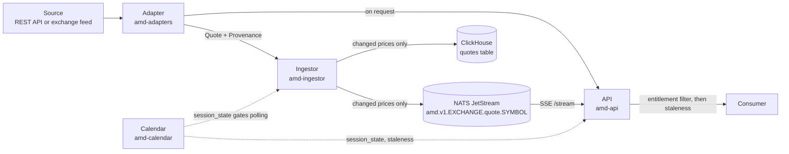

# How provenance travels: quote → bus → store → API

Provenance is attached once, at the adapter, and is never recomputed or dropped
downstream. This page follows one quote through the pipeline and says what each
stage does with it. It also lists what is **not wired yet**, so the diagram is
not read as a claim about a finished system.

Solid arrows carry the `Quote`; dotted arrows are the calendar being consulted.

## 1. Adapter: provenance is born here

An adapter builds a `Quote` and must attach a `Provenance`
(`crates/amd-core/src/provenance.rs`). The adapter is the only component that
knows what the source actually promises, so it is the only place that can
state it honestly:

| Field | Set by the adapter to |
|-------|-----------------------|
| `source` | its own id, e.g. `kwayisi` |
| `as_of` | the exchange timestamp if the source publishes one, otherwise the receive time |
| `received_at` | when this process got it |
| `delay` | the source's *licensed* delay class; `Unknown` if the source makes no claim |
| `as_of_imputed` | `true` when `as_of` is only the receive time standing in |
| `sequence`, `recovered` | feed-level details, for sources (MITCH/ITCH) that have them |

Two constructors encode the distinction: `Provenance::imputed` (no source
timestamp) and `Provenance::stamped`. The kwayisi adapter publishes no
timestamp, so it uses `imputed` with `DelayClass::Unknown`
(`crates/amd-adapters/src/kwayisi.rs`). An adapter that overstates its delay
class causes licensed data to be served to consumers not entitled to it, which
is why the rule is stated in CONTRIBUTING.

## 2. Ingestor: poll on the calendar, forward only what moved

`crates/amd-ingestor/src/main.rs` runs one task per venue.

- Polling is gated by `session_state`: outside `Open` the loop sleeps (300 s),
  inside it polls every 30 s. `AMD_FORCE_POLL` overrides this for testing only.
- On entering `PreOpen` the last-seen map is cleared, so yesterday's closes are
  not a baseline for today's first prints.
- A quote is forwarded only if its `last` price changed (compared on the
  fixed-point value). The quote is forwarded **unmodified**, provenance
  included.

Consequence worth knowing: because unchanged boards are suppressed, a consumer
of the bus or archive sees `as_of` of the last *change*, not of the last poll.
For sources with imputed timestamps, that is the receive time of the poll on
which the price moved.

The ingestor also publishes `Event::Status` on each session-state transition.

## 3. Bus: provenance rides inside the envelope

Events are JSON in an `Event` envelope tagged by `kind`
(`crates/amd-bus/src/lib.rs`). `Quote` serialises its `provenance` field
alongside the prices, so there is no separate side channel to lose. The venue is
high in the subject (`amd.v1.<EXCHANGE>.<kind>.<SYMBOL>`) so a leaf node can
export one venue. The bus is a 24-hour replay buffer, not the archive.

## 4. Store: provenance becomes columns

`QuoteRow::from_quote` (`crates/amd-store/src/clickhouse_store.rs`) flattens the
quote into the `quotes` table. Every `Provenance` field maps to a column
(`source`, `as_of`, `received_at`, `delay_class`, `as_of_imputed`, `sequence`,
`recovered`), and prices are stored as scaled integers with a shared currency
and scale. Rows that mix currencies or carry no price are rejected rather than
archived. The table is ordered by `(exchange, symbol, as_of)`.

Because `as_of_imputed` is a column, an analysis can exclude rows whose
timestamp is just the poll time. Charting those rows would plot the polling
schedule.

## 5. API: the last gate

`crates/amd-api/src/routes.rs` does three things at egress:

1. **Entitlement filter** (`entitlement::filter`). Runs against the
   `DelayClass` on each quote, not against the route or adapter. Anonymous
   callers get `Eod` and below, plus `Unknown`. `Unknown` is let through
   because withholding it would empty the free tier, not because it is proven
   licensed. The response reports a `withheld` count and what class would be
   needed, rather than silently shortening the list.
2. **Staleness annotation** (`/quotes` only). Adds `staleness_seconds` from
   `as_of`, and `stale: true` when the venue is `Open` and the age exceeds
   `stale_after` (default 900 s). This is what separates "nobody is trading it"
   from "the feed is broken".
3. **Session context.** The response carries `session_state`, and
   `/v1/exchanges` carries `sessions_verified` and `sessions_source`, so a
   consumer can see whether the schedule behind `session_state` was checked.

## Not wired yet

Stated plainly, so the diagram is not over-read:

- `/v1/exchanges/{code}/quotes` calls the adapter directly. It does **not**
  read ClickHouse, and `ClickhouseStore::latest_quotes` is not called by any
  route yet.
- API keys are not wired: `/quotes` always applies the anonymous rule
  (`entitlement::filter(quotes, None)`), and the `entitlements` store is
  unused by the routes.
- The `/stream` endpoint applies the anonymous delay check but does not add
  `staleness_seconds` or `stale`.
- Public holidays are not modelled, so `session_state` can report `Open` on a
  holiday.
- Only the kwayisi (GSE) adapter exists; the `Realtime` and `Delayed` classes
  are exercised only by the feed-handler design, not by a live source.

Update this section when any of these change.
